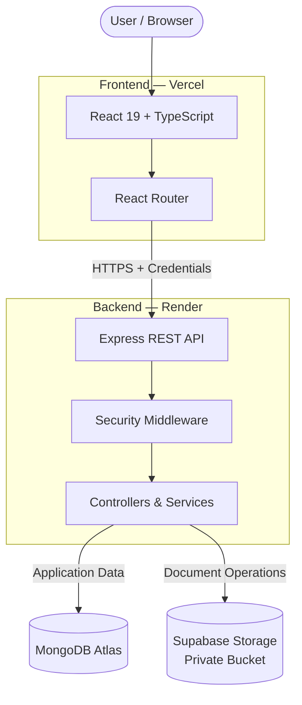
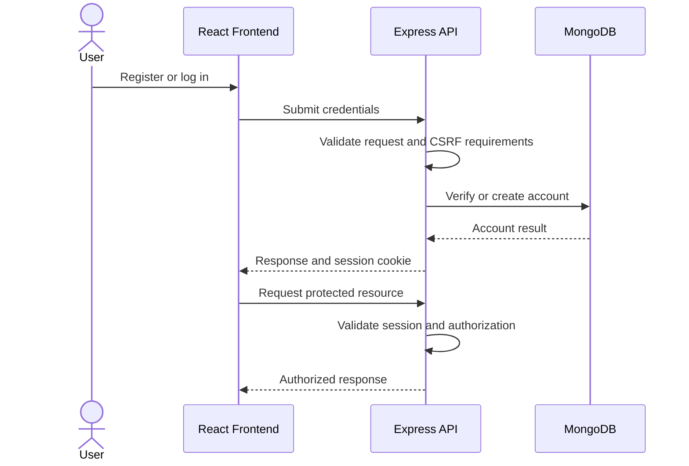

# ApnaVault

<div align="center">


### Your Family. Every Important Document. One Safe Place.

A secure family document management platform built to help Indian households organize, access, track, and share their important records.

<br/>

<a href="https://apna-vault-pprl.vercel.app">
  
</a>
<a href="https://apnavault.onrender.com/api/v1/health">
  
</a>

<br/><br/>


<br/>

[Features](#-features) · [Technology Stack](#-technology-stack) · [Architecture](#-system-architecture) · [Getting Started](#-getting-started) · [Deployment](#-deployment)

</div>

---

## About ApnaVault

ApnaVault is a family document management platform designed to bring essential household records into one organized digital space.

From identity cards and financial records to property papers and medical documents, ApnaVault aims to simplify the way families manage their important information.

**Our vision:** Make family document management simpler, more organized, and secure by design.

## ✨ Features

<table>
<tr>
<td width="50%" valign="top">

### 🔐 Authentication & Security

- User registration and login
- Session-based authentication
- Protected application routes
- CSRF protection
- Secure cookie configuration
- Server-side request validation

</td>
<td width="50%" valign="top">

### 📁 Document Management

- Document upload and download
- Document metadata management
- Folder-based organization
- Document deletion
- Per-user storage quota enforcement
- Private cloud storage integration

</td>
</tr>
<tr>
<td width="50%" valign="top">

### 👨‍👩‍👧‍👦 Family Collaboration

- Family invitation workflows
- Invitation status management
- Shared-resource access workflows
- Permission-aware backend operations

</td>
<td width="50%" valign="top">

### 🔔 Reminders & Dashboard

- Document-related reminders
- Notification workflows
- Dashboard and account management
- Profile and settings functionality

</td>
</tr>
</table>

> Feature availability depends on the implemented workflow and its configuration. Authentication, storage, invitations, reminders, and notifications should be verified end-to-end before being considered production-ready.

## 🧰 Technology Stack

<div align="center">

### Frontend

<a href="https://react.dev/"></a>
<a href="https://vite.dev/"></a>
<a href="https://www.typescriptlang.org/"></a>
<a href="https://developer.mozilla.org/en-US/docs/Web/CSS"></a>

<br/>
React 19 · Vite · TypeScript · React Router · CSS

### Backend

<a href="https://nodejs.org/"></a>
<a href="https://expressjs.com/"></a>
<a href="https://www.typescriptlang.org/"></a>

<br/>
Node.js · Express 4 · TypeScript · REST API

### Database & Storage

<a href="https://www.mongodb.com/"></a>
<a href="https://supabase.com/"></a>

<br/>
MongoDB Atlas · Mongoose · Supabase Storage

### Security & Validation

<a href="https://zod.dev/"></a>
<a href="https://helmetjs.github.io/"></a>

<br/>
Zod · Helmet · CORS · Session Authentication · CSRF Protection

### Deployment & Development

<a href="https://vercel.com/"></a>
<a href="https://render.com/"></a>
<a href="https://github.com/"></a>
<a href="https://www.npmjs.com/"></a>

<br/>
Vercel · Render · Git · GitHub · npm Workspaces

</div>

## 🏗️ System Architecture

ApnaVault uses a monorepo architecture with separate frontend and backend workspaces.



### Architecture responsibilities

| Component | Responsibility |
|---|---|
| React frontend | User interface, navigation, and client-side state |
| Express API | Business logic, request handling, and API responses |
| Authentication middleware | Session validation and protected operations |
| MongoDB Atlas | Application records and document metadata |
| Supabase Storage | Document binary storage |
| Vercel | Frontend hosting |
| Render | Backend hosting |

## 🔄 Core Workflows

### Authentication



### Document lifecycle

1. User selects a document.
2. The frontend submits the request to the backend.
3. The backend validates the session, request, file, and quota.
4. The server performs the storage operation.
5. Document metadata is persisted in MongoDB.
6. The frontend displays the operation result.

Downloads and deletions must also verify access on the backend. Storage paths and document IDs must not independently grant access.

## 📂 Project Structure

```text
ApnaVault/
├── client/
│   ├── src/
│   │   ├── components/
│   │   ├── context/
│   │   ├── routes/
│   │   ├── App.tsx
│   │   └── main.tsx
│   ├── index.html
│   ├── vercel.json
│   ├── package.json
│   └── vite.config.ts
│
├── server/
│   ├── src/
│   │   ├── config/
│   │   ├── controllers/
│   │   ├── middleware/
│   │   ├── models/
│   │   ├── routes/
│   │   ├── services/
│   │   ├── tests/
│   │   ├── utils/
│   │   ├── app.ts
│   │   └── index.ts
│   ├── package.json
│   └── tsconfig.json
│
├── .env.example
├── package.json
└── README.md
```

*This is a representative structure; consult the repository for the complete current file inventory.*

## 🚀 Getting Started

### Prerequisites

- Node.js 20+
- npm 10+
- MongoDB Atlas or a suitable local replica set
- Supabase project with a private document bucket
- Git

### 1. Clone the repository

```bash
git clone https://github.com/altafshaikh7/ApnaVault.git
cd ApnaVault
```

### 2. Install dependencies

```bash
npm install
```

### 3. Configure the backend

Copy the environment template.

**Windows PowerShell:**

```powershell
Copy-Item server/.env.example server/.env
```

Configure `server/.env` with the required database, session, and storage values. Never commit this file.

### 4. Configure the frontend

For local development, set the API base URL in the client environment configuration if required:

```dotenv
VITE_API_URL=http://localhost:5000/api/v1
```

### 5. Start the application

Run both applications:

```bash
npm run dev
```

Or start them separately:

```bash
npm run dev:server
npm run dev:client
```

| Service | Local URL |
|---|---|
| Frontend | `http://localhost:5173` |
| Backend | `http://localhost:5000` |
| API health | `http://localhost:5000/api/v1/health` |

## ⚙️ Environment Variables

| Variable | Purpose |
|---|---|
| `NODE_ENV` | Runtime environment |
| `PORT` | Backend port; defaults to `5000` |
| `CLIENT_URL` | Allowed frontend origin |
| `FRONTEND_URL` | Frontend origin used by the backend |
| `SESSION_SECRET` | Session signing secret |
| `MONGODB_URI` | MongoDB connection string |
| `SUPABASE_URL` | Supabase project URL |
| `SUPABASE_SERVICE_ROLE_KEY` | Server-side Supabase credential |
| `SUPABASE_STORAGE_AUTHORIZATION_JWT` | Existing legacy service-role JWT when required |
| `SUPABASE_BUCKET_NAME` | Private storage bucket name |
| `APP_STORAGE_QUOTA_BYTES` | Per-user storage quota; defaults to `996147200` |
| `VITE_API_URL` | Frontend API base URL |

Production requires explicit environment configuration, a unique session secret of at least 32 characters, HTTPS frontend origins, and server-only storage credentials.

**Never expose service-role credentials or session secrets in frontend variables.**

## 🛡️ Security Principles

- Session-based authentication for protected operations.
- CSRF protection for applicable browser requests.
- Secure production cookie settings.
- Explicit CORS origin configuration.
- Helmet security headers.
- Server-side request and environment validation.
- Private Supabase document bucket.
- Backend authorization for document and shared-resource access.
- Centralized operational error handling.
- No production secrets in Git.

The production frontend and backend use different hostnames. Cross-site cookies may be blocked by some browser privacy settings; a same-site custom-domain configuration is a more reliable long-term option.

## ☁️ Deployment

<div align="center">

<a href="https://vercel.com/">

</a>

<a href="https://render.com/">

</a>

<a href="https://www.mongodb.com/atlas">

</a>

<a href="https://supabase.com/">

</a>

</div>

### Production URLs

| Service | URL |
|---|---|
| Web application | https://apna-vault-pprl.vercel.app |
| Backend API | https://apnavault.onrender.com |
| Health endpoint | https://apnavault.onrender.com/api/v1/health |

### Vercel frontend

- Set the project root directory to `client`.
- Use the Vite build configuration.
- Set the output directory to `dist`.
- Configure `VITE_API_URL` to the production API base URL.
- Ensure `client/vercel.json` supports client-side route refreshes.

### Render backend

Build command:

```bash
npm install --include=dev && npm run build --workspace=server
```

Start command:

```bash
npm run start --workspace=server
```

Health check path:

```text
/api/v1/health
```

Configure `NODE_ENV=production` and all required backend environment variables in the Render dashboard.

## 🧪 Available Scripts

| Command | Description |
|---|---|
| `npm run dev` | Start client and server |
| `npm run dev:client` | Start frontend only |
| `npm run dev:server` | Start backend only |
| `npm run build` | Build both workspaces |
| `npm run build:client` | Build frontend |
| `npm run build:server` | Build backend |
| `npm run type-check` | Type-check workspaces |
| `npm run type-check:client` | Type-check frontend |
| `npm run type-check:server` | Type-check backend |
| `npm run test:integration:supabase` | Run configured live Storage smoke test |

Run scripts from the repository root. Check `package.json` for the authoritative list of available scripts.

## ✅ Production Verification Checklist

- [ ] Frontend and backend builds pass.
- [ ] Health endpoint reports a connected database.
- [ ] Registration, login, and logout work.
- [ ] Authentication persists correctly after refresh.
- [ ] Protected routes load directly.
- [ ] CSRF and CORS behave correctly.
- [ ] Document upload, download, and deletion work with real storage.
- [ ] Storage quota and access permissions are enforced.
- [ ] Family invitations and sharing are tested.
- [ ] Reminder and notification workflows are tested.
- [ ] Production secrets remain server-side.

A successful deployment does not, by itself, establish that every application feature has passed production testing.

## 🗺️ Roadmap

- [ ] Complete end-to-end verification of document operations.
- [ ] Strengthen regression tests for authentication and storage.
- [ ] Verify family invitation and sharing permissions.
- [ ] Verify reminder scheduling and notifications.
- [ ] Improve operational monitoring and failure recovery.
- [ ] Consider same-site custom domains for authentication reliability.

## 🤝 Contributing

Contributions and suggestions are welcome.

1. Fork the repository.
2. Create a focused feature branch.
3. Implement and test your changes.
4. Review the diff for unintended changes and secrets.
5. Submit a pull request with a clear description.

## 📄 License

No license is specified here yet. Add a `LICENSE` file when the project's intended license is decided.

---

<div align="center">

### ApnaVault

**Your Family. Every Important Document. One Safe Place.**

Built to make family document management simpler and more organized.

<br/>

<a href="https://github.com/altafshaikh7/ApnaVault">

</a>

</div>